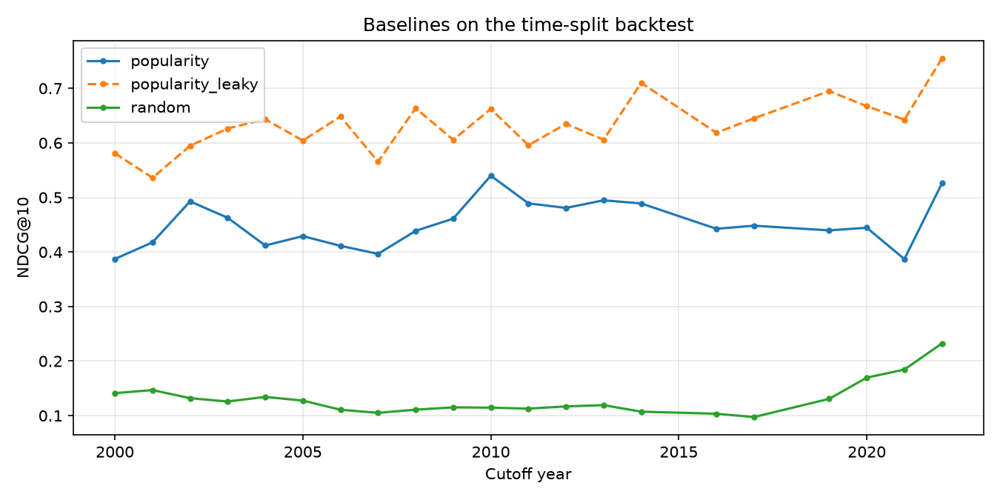

# NextWatch: what to watch in theaters, based on movies you love

Pick a few movies you've loved, and this app ranks what's currently in theaters
by how well each one matches your taste, using hybrid search (BM25 + dense
embeddings) and a learning-to-rank re-ranker.

New releases have almost no ratings, so collaborative filtering can't
recommend them. This project treats recommendation as a **content-based
retrieval problem** and evaluates it with a time-split backtest on 32M
MovieLens ratings.

> Status: **Milestone 2 — time-split backtest and baselines** ✅

## Results so far

Test split (45 monthly cutoffs, Jan 2019 – Sep 2022, 55K user queries). 95%
confidence intervals in parentheses come from a bootstrap over cutoff dates.

| Method | NDCG@10 | Recall@5 | MRR |
|---|---|---|---|
| Random | 0.172 (0.157–0.189) | 0.175 (0.159–0.193) | 0.165 (0.156–0.176) |
| **Popularity (baseline to beat)** | **0.444** (0.388–0.504) | **0.502** (0.427–0.576) | **0.447** (0.387–0.510) |
| *Popularity, leaky (invalid)* | *0.688* (0.650–0.721) | *0.772* (0.737–0.803) | *0.655* (0.610–0.694) |

The leaky row ranks by each movie's *eventual* rating count, which includes
the ratings being predicted. It overstates popularity's NDCG@10 by 55%, which
is why every number here is computed only from data available on the cutoff date.



## How the backtest works

For each monthly cutoff date T, the backtest replays the app as if someone
used it that day:

- **In theaters:** movies first released in the 6 weeks before T that eventually
  reached 50+ ratings, about 44 per cutoff, close to a real wide-release lineup.
- **Users:** people with 5+ ratings before T who rated a candidate later.
- **Ground truth:** the candidates each user rated 4+ stars within a year after T.
- **What models can use:** only ratings from before T, plus movie descriptions.
  Columns computed from future data (total rating counts, today's TMDB
  popularity) are excluded via `content_catalog()`.
- **Splits:** train (2000–2014), validation (2016–2017) and test (2019–2022),
  separated by one-year gaps so labels from one split never overlap the next.

In total: 249 cutoffs, 317K user queries, 30K distinct users. Tests cover the
leakage rules on a small hand-built dataset, check NDCG against
scikit-learn, and the window builder was cross-checked against a plain pandas
implementation on real data.

## Setup

```bash
python3 -m venv .venv
source .venv/bin/activate
pip install -r requirements.txt
cp .env.example .env   # then paste your TMDB API Read Access Token into .env
```

Get a free TMDB token at <https://www.themoviedb.org/settings/api>. Use the
long **API Read Access Token**, not the short API key.

## Data pipeline

```bash
# Quick iteration: ~9.7K movies, ~100K ratings (about 5 minutes of TMDB calls)
python -m movierec.build_catalog --dataset small

# Full dataset: ~87K movies, 32M ratings (~240 MB download, roughly an hour of TMDB calls)
python -m movierec.build_catalog --dataset 32m

# Snapshot what's in theaters today (run daily to build a history)
python -m movierec.now_playing --region US
```

TMDB responses are cached in `data/cache/tmdb.sqlite`, so re-runs only fetch
what's missing and an interrupted run picks up where it left off.

## Running the backtest

```bash
# All splits on the full dataset (~2 minutes after the catalog is built)
python -m movierec.evaluate --dataset 32m --plot docs/backtest_baselines.png
```

Per-query results, a summary CSV and a markdown table are written to
`data/results/<dataset>/`.

### Outputs

| File | Contents |
|---|---|
| `data/processed/<dataset>/catalog.parquet` | One row per movie: MovieLens id/title/year/genres, rating stats, and TMDB overview, keywords, genres, directors, writers, top-5 cast, runtime, popularity, release date |
| `data/processed/<dataset>/ratings.parquet` | `userId, movieId, rating, timestamp` with compact dtypes |
| `data/now_playing/<date>_<region>.parquet` | Movies in theaters on that date, same TMDB columns as the catalog |

## Project layout

```
movierec/
  config.py         paths, env vars
  movielens.py      download + load MovieLens, rating stats
  tmdb.py           TMDB client (retries, rate limits), SQLite cache, flattening
  build_catalog.py  CLI: MovieLens + TMDB -> catalog.parquet
  now_playing.py    CLI: today's in-theater movies -> parquet
  backtest.py       time-split windows: candidates, users, ground truth
  metrics.py        NDCG@k, Recall@k, MRR (vectorized NumPy)
  baselines.py      random, popularity, and leaky popularity rankers
  evaluate.py       CLI: run rankers, bootstrap CIs, results table + chart
tests/              pytest suite (no network or token needed)
```

## Roadmap

1. ✅ Data pipeline: MovieLens + TMDB catalog, now-playing snapshots
2. ✅ Time-split backtest + popularity baseline
3. BM25, dense retrieval, reciprocal rank fusion
4. LambdaMART re-ranker + ablation table (NDCG@10, Recall@5, MRR)
5. App with live now-playing list and "because you liked…" explanations
6. Write-up

## Attribution

This product uses the TMDB API but is not endorsed or certified by TMDB.
Ratings data from [MovieLens](https://grouplens.org/datasets/movielens/)
(F. Maxwell Harper and Joseph A. Konstan, 2015).
